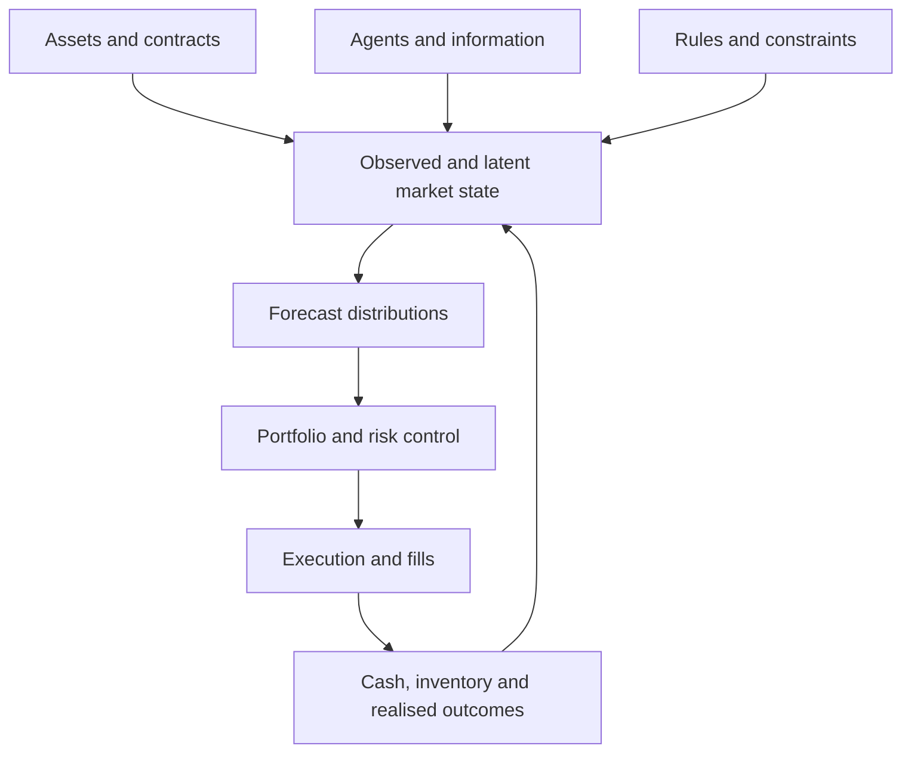

**The coherent framework is “Aggregation, Markets and Control”: exact aggregation identities form its foundation; graph dynamics, market behaviour and trading policies sit above them as separately testable models.**

The workspace became unavailable before I could export and save the downloadable files. I couldn’t make the PDF or source bundle available. To preserve a usable deliverable, the consolidated Markdown text is below. It includes the mathematical workings, evidence tables, graph structure, conjectures and a concrete testing programme. The original graphical panels still need to be incorporated into the exported edition.

**Mark Daniel Balle Brezina — Tomorrow Capital Research**  
**Research synthesis · 6 November 2026**

# 1. Purpose and central thesis

This document consolidates a research programme concerning aggregation, collective behaviour, multilayer financial markets, asset networks, interacting agents and trading control.

The starting observation is simple:

> Some quantities survive aggregation exactly. Other quantities change because aggregation hides internal differences. Those hidden differences can matter for the future behaviour of the aggregate.

This statement contains three distinct propositions.

1. **An accounting proposition:** appropriately defined additive quantities match exactly.
2. **A geometric proposition:** quadratic quantities admit a decomposition into collective and internal components.
3. **A dynamical proposition:** internal components may influence the future evolution of the aggregate.

The first two can often be established mathematically. The third requires assumptions about dynamics and empirical testing.

The financial extension is:

> A market can be represented at several resolutions—as individual orders, assets, portfolios, sectors and markets—and through several interacting layers, including valuation, information, liquidity and participant constraints. A useful model must describe what each aggregation preserves, what it discards, and whether the discarded information improves prediction or control.

The framework is therefore a programme for constructing and testing models. It does not establish that all complex systems obey the same dynamics, that a particular valuation surface is objectively observable, or that aggregation identities generate profitable trading strategies.

## 1.1 The organising structure

The research separates into five connected components.

| Component | Principal question |
|---|---|
| Aggregation | What is preserved, and what is lost, when components are combined? |
| Dynamics | Does the aggregate evolve autonomously, or does it retain dependence on internal state? |
| Market representation | How should assets, agents, information and constraints be represented together? |
| Decision and control | How should forecasts become positions and executable orders? |
| Validation | Which claims survive independent data, realistic accounting and competing explanations? |

A mathematical identity, an empirical regularity and a successful trading policy are different results. Evidence for one does not automatically establish the others.

## 1.2 Evidence categories

Every substantive claim should carry an evidence category.

| Category | Meaning |
|---|---|
| **Identity** | Follows algebraically from stated definitions. |
| **Conditional result** | Follows under explicit mathematical assumptions. |
| **Hypothesis** | A falsifiable proposition awaiting an adequate test. |
| **Reported result** | Appears in an earlier document, but the underlying experiment has not been independently reproduced here. |
| **Attached numerical evidence** | Numerical output is present in supplied files and can be inspected. |
| **New calculation** | Recomputed directly from supplied data during this consolidation. |
| **Illustration** | A synthetic example explaining a mechanism, rather than evidence about real markets. |

This distinction is especially important because some documents describe completed experiments while associated notebooks, raw inputs or final numerical outputs are absent.

# 2. The mathematical core

## 2.1 Objects, weights and units

Let \(x_i\in\mathbb R^d\) describe component \(i\), with weights

\[
w_i\geq 0,
\qquad
\sum_{i=1}^{n}w_i=1.
\]

Define the aggregate

\[
\bar x=\sum_iw_ix_i.
\]

The interpretation depends on the system.

- \(x_i\) may be a velocity and \(w_i\) a mass fraction.
- \(x_i\) may be an asset return and \(w_i\) an initial portfolio weight.
- \(x_i\) may be a response vector and \(w_i\) a population share.
- \(x_i\) may be a feature vector and \(w_i\) a statistical sampling weight.

The algebra is shared; the physical or economic meanings are not interchangeable.

For unnormalised positive masses \(a_i\), let

\[
A=\sum_i a_i,
\qquad
w_i=\frac{a_i}{A}.
\]

Then the additive total is \(A\bar x=\sum_i a_ix_i\).

Signed portfolio weights require separate treatment. The positive-weight inequalities developed below do not automatically hold for long–short positions.

## 2.2 Additive matching

If a quantity is additive under the chosen aggregation,

\[
Q=\sum_iQ_i,
\]

then the aggregate total matches exactly.

Examples include:

- total four-momentum of a specified particle system;
- total momentum of a specified collection of bodies;
- the value of a portfolio as the sum of marked positions and cash;
- the initial-weighted simple return of a portfolio over an interval, under the appropriate accounting assumptions;
- total executed volume over disjoint trade records.

“Additive” and “conserved” must be distinguished.

An additive quantity can change because of external flows. A portfolio’s value is additive but is not constant. Momentum is additive, but a selected subsystem’s momentum changes under external forces.

For an open system, the relevant structure is a balance equation:

\[
\text{change in stock}
=
\text{inflows}
-
\text{outflows}
+
\text{sources}
-
\text{sinks}.
\]

A useful model must specify the system boundary.

## 2.3 The exact quadratic decomposition

For the Euclidean norm,

\[
\boxed{
\sum_iw_i\|x_i\|^2
=
\left\|\sum_iw_ix_i\right\|^2
+
\sum_iw_i\|x_i-\bar x\|^2
}
\]

Define

\[
E_{\mathrm{total}}=\sum_iw_i\|x_i\|^2,
\]

\[
E_{\mathrm{collective}}=\|\bar x\|^2,
\]

\[
E_{\mathrm{internal}}=\sum_iw_i\|x_i-\bar x\|^2.
\]

Then

\[
E_{\mathrm{total}}
=
E_{\mathrm{collective}}
+
E_{\mathrm{internal}}.
\]

The proof follows by writing \(x_i=\bar x+\delta_i\), where

\[
\sum_iw_i\delta_i=0.
\]

Expanding gives

\[
\begin{aligned}
\sum_iw_i\|x_i\|^2
&=
\sum_iw_i
\left(
\|\bar x\|^2
+2\bar x^\top\delta_i
+\|\delta_i\|^2
\right)\\
&=
\|\bar x\|^2
+
\sum_iw_i\|\delta_i\|^2.
\end{aligned}
\]

The cross-term vanishes exactly.

This is the strongest general version of the proposed matching rule.

## 2.4 What the gap measures

The gap

\[
G
=
E_{\mathrm{total}}
-
E_{\mathrm{collective}}
=
E_{\mathrm{internal}}
\]

measures weighted dispersion around the aggregate.

Its interpretation depends on \(x_i\).

| Component variable | Interpretation of the gap |
|---|---|
| Velocity | Internal kinetic motion, after the appropriate mass and \(1/2\) factors |
| Return | Cross-sectional return dispersion |
| Signal | Disagreement between component signals |
| Response vector | Variation in direction or amplitude |
| Position proposal | Disagreement among strategies or accounts |

It is not generally a direct measure of entropy, inefficiency, profitability, hidden mass or available energy.

Those interpretations need additional models.

## 2.5 Collective share

Provided \(E_{\mathrm{total}}>0\), define

\[
\kappa_2
=
\frac{E_{\mathrm{collective}}}{E_{\mathrm{total}}}.
\]

For positive normalised weights,

\[
0\leq\kappa_2\leq1,
\qquad
1-\kappa_2
=
\frac{E_{\mathrm{internal}}}{E_{\mathrm{total}}}.
\]

Examples:

- If every \(x_i\) is identical, \(\kappa_2=1\).
- If two equally weighted components are \(x\) and \(-x\), \(\kappa_2=0\).
- If all components are zero, the ratio is undefined unless a reporting convention is supplied.

A low collective share means that the chosen aggregate suppresses substantial component variation. It does not establish whether that variation is predictable.

## 2.6 General positive quadratic forms

The same identity holds for

\[
\|x\|_G^2=x^\top Gx
\]

when \(G\) is a fixed symmetric positive semidefinite matrix:

\[
\sum_iw_ix_i^\top Gx_i
=
\bar x^\top G\bar x
+
\sum_iw_i(x_i-\bar x)^\top G(x_i-\bar x).
\]

This permits risk-weighted or otherwise geometrically weighted decompositions.

The choice of \(G\) is substantive. Changing it changes what counts as “large”, “close” or “internally dispersed”.

If \(G\) is estimated from the data, that estimation must be included in the validation procedure.

# 3. Aggregation across a hierarchy

Suppose components belong to groups \(g\).

Define group weights

\[
W_g=\sum_{i\in g}w_i
\]

and group means

\[
\bar x_g
=
\frac{1}{W_g}
\sum_{i\in g}w_ix_i.
\]

Then

\[
\boxed{
\sum_iw_i\|x_i\|^2
=
\|\bar x\|^2
+
\sum_gW_g\|\bar x_g-\bar x\|^2
+
\sum_g\sum_{i\in g}w_i\|x_i-\bar x_g\|^2
}
\]

The three terms represent:

1. system-wide collective behaviour;
2. variation between groups;
3. variation within groups.

This can be applied recursively.

For example:

\[
\text{assets}
\rightarrow
\text{sectors}
\rightarrow
\text{national markets}
\rightarrow
\text{global portfolio}.
\]

At each level, the decomposition states where the variation resides.

It does not imply that the selected hierarchy is economically optimal. A useful hierarchy must also be stable, interpretable and helpful for the intended prediction or risk task.

## 3.1 Group selection must be tested

A grouping algorithm can always reduce measured within-group dispersion by creating more groups. Singleton groups have zero within-group dispersion.

Therefore, a claim that a learned grouping discovers “coherent structure” needs comparison with:

- random groups of the same sizes;
- simple sector or asset-class groups;
- groups estimated on earlier data;
- complexity penalties;
- performance on later data.

The important question is whether a compact grouping preserves useful information beyond what trivial partitioning achieves.

# 4. Financial aggregation and covariance

## 4.1 The exact portfolio-return relationship

Let \(w_{i,t}\) denote portfolio weights immediately before the return interval.

Under appropriate treatment of financing, external cash flows and corporate actions,

\[
r_{p,t+1}
=
\sum_iw_{i,t}r_{i,t+1}.
\]

For a buy-and-hold portfolio, weights drift after returns occur. Constant weights across intervals describe a rebalanced strategy and therefore imply transactions.

The return identity does not make those transactions free.

Log returns do not obey the same weighted-sum identity:

\[
\log(1+r_p)
\neq
\sum_iw_i\log(1+r_i)
\]

in general.

Likewise, an index’s historical return cannot be reconstructed reliably by applying today’s constituents and weights to the entire past.

## 4.2 Variance decomposition

Let \(r\) be the vector of asset returns and \(\Sigma\) its covariance matrix.

Then

\[
\sigma_p^2=w^\top\Sigma w.
\]

For fixed positive normalised weights,

\[
\sum_iw_i\operatorname{Var}(r_i)
=
\operatorname{Var}(r_p)
+
\sum_iw_i\operatorname{Var}(r_i-r_p).
\]

Define the variance-based collective share

\[
\kappa_v
=
\frac{w^\top\Sigma w}
{\sum_iw_i\sigma_i^2}.
\]

This is distinct from an uncentred second-moment share:

\[
\kappa_2
=
\frac{\mathbb E[r_p^2]}
{\sum_iw_i\mathbb E[r_i^2]}.
\]

The two may be numerically close for sufficiently short-horizon returns with small means, but they are not identical by definition.

## 4.3 The volatility ratio is a different statistic

Define

\[
\Psi
=
\frac{\sigma_p}{\sum_iw_i\sigma_i}.
\]

Then

\[
\kappa_v
=
\Psi^2
\frac{\left(\sum_iw_i\sigma_i\right)^2}
{\sum_iw_i\sigma_i^2}.
\]

Consequently,

\[
\kappa_v\leq\Psi^2
\]

for positive normalised weights.

If all component volatilities are equal,

\[
\kappa_v=\Psi^2.
\]

Therefore, expected values for \(\kappa\) and for the volatility ratio must be checked for compatibility under the chosen weights and volatility distribution. They should not be treated as independent descriptions of the same number.

## 4.4 Correlation and concentration

If all assets have volatility \(\sigma\) and common pairwise correlation \(\rho\), then

\[
\kappa_v
=
\rho+(1-\rho)\sum_iw_i^2.
\]

For equal weights,

\[
\kappa_v
=
\rho+\frac{1-\rho}{n}.
\]

This identifies two sources of collective variance:

- common movement;
- concentration in individual components.

Even independent assets have a nonzero collective share in a finite basket.

For two equally weighted assets with equal volatility,

\[
\kappa_v=\frac{1+\rho}{2}.
\]

Comparisons across baskets should therefore control for asset count, concentration and volatility heterogeneity.

## 4.5 Pooling observations correctly

Two common summaries are different:

\[
\frac1T\sum_t
\frac{E_{\mathrm{collective},t}}
{E_{\mathrm{total},t}}
\]

and

\[
\frac{\sum_tE_{\mathrm{collective},t}}
{\sum_tE_{\mathrm{total},t}}.
\]

The second is a total-energy-weighted average of the period-specific ratios. The first gives equal weight to every period.

A quiet period with a tiny denominator can dominate an unweighted average of ratios while contributing almost nothing to total variation.

Every reported \(\kappa\) should specify its pooling convention.

# 5. Time aggregation and response duration

## 5.1 Longer intervals need not produce greater coherence

Let \(r_t\) be a stationary return vector and

\[
R_t^{(h)}
=
\sum_{j=1}^{h}r_{t+j}.
\]

Writing

\[
\Gamma(k)
=
\operatorname{Cov}(r_{t+k},r_t),
\]

the covariance of the aggregated return is

\[
\operatorname{Var}(R_t^{(h)})
=
h\Gamma(0)
+
\sum_{k=1}^{h-1}
(h-k)\left[\Gamma(k)+\Gamma(k)^\top\right].
\]

Consequently, the collective share at horizon \(h\) depends on the entire relevant auto- and cross-covariance structure.

There is no general theorem requiring

\[
\kappa(h+1)\geq\kappa(h).
\]

An increase is plausible when short intervals miss common responses because of asynchronous updates or lead–lag effects.

A decrease is plausible when longer intervals introduce more heterogeneous trends, changing exposures or offsetting responses.

The direction is empirical.

## 5.2 Mixtures of delayed responses

Suppose component \(i\) responds to an event according to

\[
y_i(t)=a_i g_i(t-\tau_i).
\]

The aggregate response is

\[
Y(t)=\sum_iw_i a_i g_i(t-\tau_i).
\]

Its shape depends on:

- response amplitudes;
- signs;
- onset times;
- durations;
- the distribution of delays;
- correlations between delays and amplitudes.

A broad aggregate response can arise from narrow individual responses occurring at different times.

A small aggregate response can arise from strong but opposing component responses.

## 5.3 Support and effective width are different

If every response has compact support \([a,b]\), shifted by \(\tau_i\), then the aggregate support is contained in

\[
[\min_i\tau_i+a,\;\max_i\tau_i+b].
\]

However, logistic and Gaussian responses do not have compact support.

For them, response duration must be defined operationally, for example through:

- the 5%–95% cumulative response interval;
- a half-life;
- a threshold relative to peak amplitude;
- a fitted decay constant.

A claim about exact finite support cannot be justified using a curve whose tails are nonzero everywhere.

## 5.4 A useful mixture identity

If normalised, nonnegative response profiles can be interpreted as probability densities, mixture variance obeys

\[
\operatorname{Var}(T)
=
\mathbb E[\operatorname{Var}(T\mid i)]
+
\operatorname{Var}(\mathbb E[T\mid i]).
\]

The aggregate temporal width then decomposes into:

- average within-component width;
- dispersion of component response centres.

This interpretation fails directly for arbitrary signed responses because a signed mixture is not a probability distribution.

# 6. When can an aggregate predict itself?

## 6.1 Aggregation is not dynamical closure

Consider

\[
\dot x=Ax,
\qquad
y=Cx.
\]

We would like a closed aggregate model

\[
\dot y=By.
\]

Such a model exists exactly when

\[
CA=BC
\]

for an appropriate matrix \(B\).

Equivalently, hidden differences that leave \(Cx\) unchanged must also leave \(CAx\) unchanged.

This is stronger than requiring that internal contributions cancel at the current instant.

## 6.2 A counterexample

Consider

\[
\dot x_1=x_2,
\qquad
\dot x_2=-x_1,
\]

and observe only

\[
y=x_1.
\]

Two states with the same \(x_1\) but opposite \(x_2\) have the same observed aggregate and opposite immediate velocities.

Therefore, \(y\) alone does not determine its own future.

Adding \(\dot y\), or equivalently the missing component, closes the system.

This is the central difficulty in reducing a complicated market to a small state vector.

## 6.3 Eliminating internal variables creates memory

Partition the state:

\[
\dot y=A_{yy}y+A_{yz}z,
\]

\[
\dot z=A_{zy}y+A_{zz}z.
\]

Solving the second equation gives

\[
z(t)
=
e^{A_{zz}t}z(0)
+
\int_0^t
e^{A_{zz}(t-s)}A_{zy}y(s)\,ds.
\]

Substitution yields

\[
\dot y(t)
=
A_{yy}y(t)
+
A_{yz}e^{A_{zz}t}z(0)
+
\int_0^t
A_{yz}e^{A_{zz}(t-s)}A_{zy}y(s)\,ds.
\]

The reduced dynamics contain:

- direct aggregate evolution;
- dependence on unresolved initial conditions;
- a memory kernel.

This provides a mathematical reason why coarse market models may require lagged features, latent states or recurrent representations.

It does not establish that a particular neural architecture is needed.

## 6.4 An empirical closure test

A practical test compares:

\[
\widehat y_{t+h}=f(y_t,\text{aggregate history})
\]

with

\[
\widehat y_{t+h}
=
f(y_t,\text{aggregate history},\text{internal features}).
\]

If internal features improve genuinely out-of-sample forecasts, the original aggregate state was insufficient for that task.

This is evidence against closure of the chosen representation. It is not proof that no useful low-dimensional representation exists.

# 7. Matching across physical and financial domains

The shared principle is to preserve the correct additive objects and then study a domain-appropriate nonlinear or quadratic quantity.

The resulting gaps are related conceptually, but they are not all the same statistic.

| System | Additive object | Proposed statistic | Interpretation and status |
|---|---|---|---|
| CMS dimuons | Four-momentum | \(M/(m_1+m_2)\) | Relativistic invariant-mass excess; approximately 14.7 for a \(J/\psi\) dimuon pair |
| ATLAS four leptons | Four-momentum | \((M_{4\ell}-M_{12}-M_{34})/M_{4\ell}\) | Relative motion between the two selected dilepton systems; reported median approximately 17% |
| Open star clusters | Momentum | Dynamical/visible mass | Dynamical mass inference; expectation 1–5 is a hypothesis, not an identity |
| Random field-star groups | Momentum | Same mass ratio | A virial interpretation can be invalid because the group is not bound |
| Galaxy clusters | Momentum | Virial/stellar mass | Includes nonstellar matter and model assumptions |
| S&P 500 | Properly weighted return; summed dollar volume | \(\kappa\), \(\Psi\) | Covariance and concentration statistics |
| Crypto basket | Properly weighted basket return | \(\kappa(h)\) | Horizon-dependent collective movement |
| Order book | Event-flow and depth balances | Price response relative to imbalance-based offset | Predictive or explanatory response coefficient |

## 7.1 Relativistic systems

Using units with \(c=1\),

\[
P^\mu=\sum_i p_i^\mu,
\qquad
M^2=P^\mu P_\mu.
\]

Four-momentum adds exactly. Rest masses generally do not.

For two particles,

\[
M^2
=
m_1^2+m_2^2
+
2(E_1E_2-\mathbf p_1\cdot\mathbf p_2).
\]

For two equal masses \(m\) with relative rapidity \(\chi\),

\[
M=2m\cosh(\chi/2).
\]

Thus,

\[
\frac{M}{2m}
=
\cosh(\chi/2)\geq1.
\]

Using the referenced particle masses, the \(J/\psi\)-to-two-muon ratio is approximately

\[
\frac{3096.900}{2(105.6583755)}
\approx14.655.
\]

The invariant mass reflects energy in the centre-of-momentum frame.

The Lorentzian quadratic form is indefinite, so it should not be treated as an ordinary Euclidean variance decomposition. Its relevant inequalities depend on physical future-directed four-momenta.

## 7.2 The four-lepton gap

Let \(P_{12}\) and \(P_{34}\) be the selected dilepton four-momenta.

For physically admissible future-directed systems,

\[
M_{4\ell}\geq M_{12}+M_{34}.
\]

Hence

\[
g_{4\ell}
=
\frac{M_{4\ell}-M_{12}-M_{34}}
{M_{4\ell}}
\geq0.
\]

A measured negative value would require examination of reconstruction conventions, numerical precision or input validity.

The supplied research reports 832 events with nonnegative gaps and a median near 17%. Those numerical findings remain **reported results** because the corresponding event-level notebook was not supplied for independent reproduction.

## 7.3 Newtonian kinetic decomposition

For masses \(m_i\), total mass \(M\), velocities \(v_i\), and centre-of-mass velocity \(V\),

\[
\sum_i\frac12m_i\|v_i\|^2
=
\frac12M\|V\|^2
+
\sum_i\frac12m_i\|v_i-V\|^2.
\]

This is an exact collective/internal decomposition.

Inferring a gravitational mass from internal velocity dispersion is a separate step.

## 7.4 Why a dynamical mass ratio is not an aggregation identity

A schematic virial estimate is

\[
M_{\mathrm{dyn}}
\sim
\frac{R\sigma_v^2}{G},
\]

with a coefficient depending on geometry, tracer distribution, anisotropy and equilibrium assumptions.

Therefore,

\[
\Upsilon
=
\frac{M_{\mathrm{dyn}}}{M_{\mathrm{visible}}}
\]

depends on much more than aggregation.

Potential influences include:

- whether the system is bound;
- disequilibrium;
- binary-star motion;
- membership contamination;
- projection;
- velocity uncertainties;
- gas and other nonstellar baryonic matter;
- dark matter;
- the definition of “visible mass”.

A very large \(\Upsilon\) for a randomly assembled field-star group is primarily a warning that an equilibrium mass estimator has been applied outside its domain.

For galaxy clusters, virial mass divided by stellar mass is not the same comparison as total mass divided by total baryonic mass.

# 8. The multilayer market graph

## 8.1 Three coupled structures

The market representation contains three principal graphs or constraint structures.

| Structure | Nodes or objects | Relationships |
|---|---|---|
| Asset graph | Instruments, issuers, venues, indices, currencies | Payoff links, membership, listings, exposure, funding and empirical dependence |
| Agent graph | Investors, market makers, funds or aggregate participant classes | Information exchange, competition, common constraints and interaction |
| Rule layer | Trading permissions, margin, tick sizes, fees, calendars and mandates | Restrictions on admissible states and actions |

These should not be collapsed into one undifferentiated adjacency matrix.

A derivative link is different from a correlation edge. A correlation edge is different from a funding dependency. A causal claim requires more evidence than any of these.

## 8.2 Typed edges

An asset edge should record at least:

\[
e_{ij}
=
(\text{type},\text{direction},\text{weight},\text{validity interval},\text{provenance}).
\]

Examples:

| Edge type | Example | Meaning |
|---|---|---|
| Payoff | Underlying → option | Contractual dependence |
| Membership | Constituent → index | Aggregation rule |
| Conversion | BTC/USDT ↔ BTC/USD | Related pricing through currency conversion and venue frictions |
| Funding | Collateral → leveraged position | Financing dependency |
| Empirical | Asset A ↔ asset B | Estimated statistical relationship |
| Lead–lag | Futures → spot | A predictive relationship requiring timestamp and latency controls |

An empirical edge should also retain its estimation window and uncertainty.

## 8.3 Four valuation layers

The source framework proposes:

1. fundamental value;
2. value adjusted for financial conditions;
3. value adjusted for information and sentiment;
4. interaction and transaction price.

A schematic representation is

\[
V^{(0)}_t
\rightarrow
V^{(1)}_t
\rightarrow
V^{(2)}_t
\rightarrow
P_t.
\]

Possible layer differences are

\[
g^{(1)}_t=V^{(1)}_t-V^{(0)}_t,
\]

\[
g^{(2)}_t=V^{(2)}_t-V^{(1)}_t,
\]

\[
g^{(3)}_t=P_t-V^{(2)}_t.
\]

These quantities are not automatically identifiable from prices alone.

For example, an observed price increase could be explained by changed cash-flow expectations, discount rates, risk appetite, information interpretation or liquidity demand.

The decomposition becomes scientifically useful only when its layers have observable anchors, restrictions or separate predictive consequences.

## 8.4 A compact architecture

The feedback from execution matters because actions can affect inventory, costs and, at sufficient size, the market itself.

## 8.5 Diffusion on a graph

A simple graph model is

\[
\dot v=-Lv+s,
\]

where \(L\) is a graph Laplacian and \(s\) contains source terms.

For an undirected graph, the ordinary sum may be conserved when \(s=0\).

For a directed graph, a weighted total is conserved only when its weights satisfy

\[
w^\top L=0.
\]

A conservation claim therefore requires checking the operator and its left null space.

Similarly, graph coarsening does not automatically preserve dynamics. The same closure condition appears:

\[
CA=BC.
\]

## 8.6 What geometry contributes

A geometry can specify:

- which states are near one another;
- how costly a transition is;
- how information propagates;
- which directions correspond to common factors;
- how constraints distort feasible movement.

However, terms such as curvature, geodesic and least action need explicit definitions.

A geometric picture becomes a model only after specifying:

- a state space;
- a metric or other geometric structure;
- a transition law;
- an objective;
- boundary and jump conditions;
- observable implications.

# 9. Market state and hybrid dynamics

## 9.1 A practical state vector

A first implementation can represent the market through

\[
X_t=
(
\text{trend},
\text{volatility},
\text{liquidity},
\text{breadth},
\text{dispersion},
\text{flow},
\text{funding},
\text{inventory}
).
\]

These components should remain distinct.

For example:

- high volatility does not imply downward direction;
- a flat aggregate does not imply quiet constituents;
- a trending market can still contain short-lived reversals;
- a statistically attractive signal can be unusable because inventory or liquidity constraints bind.

A regime label is a compressed description of the state, not an explanation by itself.

## 9.2 Continuous evolution and discrete events

Markets combine gradual evolution with discrete changes:

- earnings releases;
- macro announcements;
- liquidations;
- index rebalances;
- venue interruptions;
- contract changes;
- abrupt liquidity withdrawal.

A hybrid model writes ordinary evolution between events and a reset map at events:

\[
X_{t^+}
=
R_e(X_{t^-}).
\]

The event may change both the state and the graph.

Reset maps require explicit accounting. A topology change cannot simply discard positions, obligations or accumulated cash flows.

## 9.3 Probabilistic state estimates

A state engine should preferably output probabilities:

\[
\Pr(\text{up}\mid\mathcal F_t),
\quad
\Pr(\text{down}\mid\mathcal F_t),
\quad
\Pr(\text{flat}\mid\mathcal F_t),
\]

alongside uncertainty for volatility and liquidity states.

Hard classifications hide ambiguity.

The relevant validation includes calibration, stability, transition behaviour and whether the state probabilities improve decisions beyond a simpler baseline.

# 10. Equilibrium: four different concepts

The word equilibrium appears in several distinct roles.

| Concept | Meaning |
|---|---|
| Statistical reference | An estimated centre, moving average or conditional mean |
| Economic valuation | A model-based value grounded in cash flows, discounting or other assumptions |
| Dynamical equilibrium | A state or distribution maintained by a specified evolution law |
| Strategic equilibrium | A policy profile in which agents have no profitable unilateral deviation under the model |

These concepts can be related, but none should be silently substituted for another.

In particular, a moving average is not established as an economic equilibrium merely because a residual around it looks stationary.

## 10.1 The moving-reference trap

Let price follow a martingale:

\[
\mathbb E[x_{t+h}\mid\mathcal F_t]=x_t.
\]

Define an exponential moving average

\[
q_t=(1-\alpha)q_{t-1}+\alpha x_t
\]

and residual

\[
z_t=x_t-q_t.
\]

Write \(\beta=1-\alpha\). Then

\[
\mathbb E[q_{t+h}\mid\mathcal F_t]
=
\beta^h q_t+(1-\beta^h)x_t,
\]

so

\[
\boxed{
\mathbb E[z_{t+h}\mid\mathcal F_t]
=
\beta^h z_t
}
\]

and

\[
\mathbb E[z_{t+h}-z_t\mid\mathcal F_t]
=
(\beta^h-1)z_t.
\]

The residual exhibits conditional reversion even though expected future price change is zero.

The moving reference catches up with price.

## 10.2 The essential accounting identity

For any reference process \(q_t\),

\[
x_{t+h}-x_t
=
(z_{t+h}-z_t)
+
(q_{t+h}-q_t).
\]

Therefore, residual closure must be separated into:

- actual price movement;
- reference movement.

A strategy cannot earn the second component simply by observing it.

## 10.3 Tests that separate the mechanisms

For every proposed equilibrium-reversion signal, measure:

1. the subsequent price return;
2. movement of the reference;
3. closure of the residual;
4. performance against a frozen reference fixed at entry;
5. performance against martingale and shuffled controls;
6. executable profit after costs.

The primary economic target is future tradable return, not the visual attractiveness of a detrended chart.

## 10.4 Latent equilibrium models

A state-space model may posit a latent value \(v_t\) and an observed price \(p_t\):

\[
v_{t+1}=v_t+\eta_{t+1},
\]

\[
p_t=v_t+\epsilon_t.
\]

Richer versions add persistent dislocations, liquidity states or mean-reverting deviations.

Such a model can be useful, but its success depends on identification and out-of-sample forecast quality. A Kalman filter estimates the state implied by its model; it does not independently prove that the estimated state is the market’s true value.

# 11. Order flow, book imbalance and price response

## 11.1 Depth is a stock with event flows

At a fixed price level,

\[
\Delta D
=
\text{new limit orders}
-
\text{cancellations}
-
\text{executions}.
\]

Changes in the best price and the chosen reference frame complicate comparisons between snapshots.

A book reconstruction must preserve event ordering and distinguish absolute price levels from levels indexed relative to the current best quote.

## 11.2 Weighted mid-price

Let

- \(b\): best bid;
- \(a\): best ask;
- \(Q_b\): best-bid depth;
- \(Q_a\): best-ask depth.

The mid-price is

\[
m=\frac{a+b}{2}.
\]

A common imbalance-weighted price is

\[
m_w
=
\frac{aQ_b+bQ_a}{Q_b+Q_a}.
\]

Its offset is

\[
m_w-m
=
\frac{a-b}{2}
\frac{Q_b-Q_a}{Q_b+Q_a}.
\]

It is bounded by half the spread.

This weighted mid-price should be distinguished from a model-based micro-price incorporating future state transitions. Stoikov’s micro-price framework makes that distinction relevant to empirical interpretation.

## 11.3 Why a response ratio may be large

The pointwise ratio

\[
\frac{m_{t+h}-m_t}{m_{w,t}-m_t}
\]

is unstable when the denominator is near zero.

A more useful specification is

\[
m_{t+h}-m_t
=
a_h+k_h(m_{w,t}-m_t)
+\gamma_h^\top Z_t+\varepsilon_{t+h}.
\]

Here \(k_h\) measures a fitted response under the model and controls.

A large \(k_h\) need not imply amplification of a conserved quantity. It can result from a small bounded predictor, persistent correlated flow, omitted variables or the chosen units.

## 11.4 Prediction versus contemporaneous explanation

Order-flow imbalance can explain contemporaneous price changes without forecasting later returns.

The experiment must identify:

- when the predictor becomes observable;
- the last event included in the predictor;
- the first event included in the target;
- exchange versus receive timestamps;
- execution latency;
- spread and fill assumptions.

A regression that includes information from the target interval is not a deployable forecast.

# 12. The five conjecture families

The earlier conjectures can be retained, but their mathematical and empirical claims should be separated.

## 12.1 Conjecture I: dynamic strategy reallocation

**Question:** How should an existing position transition toward a new target after a model update or regime change?

Let \(\theta_t^{\mathrm{old}}\) and \(\theta_t^{\mathrm{new}}\) be candidate position paths. One restricted transition is

\[
\theta_t
=
(1-u_t)\theta_t^{\mathrm{old}}
+
u_t\theta_t^{\mathrm{new}},
\qquad
u_t\in[0,1].
\]

A possible objective is

\[
\min
\mathbb E\left[
\sum_t
\lambda_t
\|\theta_t-\theta_t^{\mathrm{new}}\|^2
+
C_t(\Delta\theta_t)
+
R_t(\theta_t)
\right].
\]

This balances target tracking, execution costs and risk.

**Necessary qualifications**

- “Shortest” requires a specified metric or cost.
- Dynamic consistency requires appropriate treatment of state, information and objective.
- A new information update can rationally change the optimal remaining plan.
- The best admissible transition need not remain on a convex interpolation between two strategy paths.

**Test:** Compare immediate switching, fixed gradual switching, no switching and model-based switching on the same forecast updates and funded ledger.

## 12.2 Conjecture II: central pricing

**Question:** Can a combination of history, market structure and participant-state information improve forecasts of future prices or returns?

Define

\[
\widehat P_{t+h}
=
F_h(\mathcal F_t,\widehat m_t),
\]

where \(\widehat m_t\) is an estimated participant-state distribution.

The existence of a conditional expectation is not the empirical conjecture. The useful conjecture is that an estimable model beats specified baselines and produces economically meaningful decisions.

The original immediate/historical mixture should combine quantities with compatible units. It can be expressed more clearly as a mixture of forecasts:

\[
\widehat r_{t+h}
=
\alpha_t\widehat r^{\mathrm{micro}}_{t+h}
+
(1-\alpha_t)\widehat r^{\mathrm{history}}_{t+h}.
\]

**Test:** Measure forecast loss, calibration, stability and net decision value against random-walk, simple autoregressive and volatility-aware baselines.

For prediction regions, distinguish marginal coverage from simultaneous coverage of an entire multi-asset future path.

## 12.3 Conjecture III: execution with limited information leakage

**Question:** How should a required position change be distributed through time and available execution channels?

For trades \(q_k\),

\[
\sum_kq_k=Q.
\]

A workable objective is

\[
\min_\pi
\mathbb E[
\text{implementation shortfall}
+
\lambda\,\text{inventory risk}
+
\eta\,\text{information leakage}
].
\]

All terms require operational definitions.

**A correction to the square-root argument**

If footprint is defined additively as

\[
\sum_{k=1}^{n}\sqrt{q_k},
\qquad q_k\geq0,
\]

then equal slicing gives

\[
n\sqrt{Q/n}=\sqrt{nQ},
\]

which increases with the number of slices.

Therefore, this particular additive concave objective does not support the claim that finer slicing reduces total footprint.

A realistic benefit from slicing must arise through a more complete mechanism: impact decay, liquidity replenishment, nonlinear cost aggregation, participation limits or a model of what other participants can infer.

Existence of an optimum also requires conditions such as a suitably compact admissible set and lower-semicontinuous costs. It does not follow for arbitrary functionals.

## 12.4 Conjecture IV: optimal policies in the full market model

**Question:** Does a specified hybrid, multilayer market model admit optimal policies or an equilibrium?

The single-agent version resembles a stochastic control problem:

\[
V_t(x)
=
\sup_{a\in A_t(x)}
\mathbb E\left[
r_t(x,a,X_{t+1})
+
V_{t+1}(X_{t+1})
\mid X_t=x
\right].
\]

The multi-agent version requires an equilibrium concept.

**Qualifications**

- Existence, uniqueness and computational tractability are separate questions.
- A finite-state approximation may admit a solution even when a broad continuous model needs additional assumptions.
- A Markov feedback solution is not automatically a geodesic or least-action trajectory.
- A solved model can still be empirically misspecified.

**Test:** Begin with a small fully specified model, establish its mathematical properties and compare its policies with simple controls before adding further layers.

## 12.5 Conjecture V: local objectives and global performance

**Question:** Can optimising modules separately produce an optimal overall trading organisation?

In general, no.

Separate modules can compete for:

- capital;
- inventory;
- liquidity;
- risk capacity;
- execution priority.

Two individually attractive strategies can create an undesirable combined concentration or turnover pattern.

A decomposed solution can work under additional structure, such as separable objectives and properly coordinated shared constraints.

For example, a common risk or capital multiplier can communicate the cost of using a scarce resource to individual modules.

**Test:** Compare independently optimised modules with joint optimisation under identical resources and constraints.

# 13. From forecasts to funded decisions

## 13.1 The ledger is the economic foundation

Let \(c_t\) be cash, \(q_t\) inventory and \(p_t\) marked prices.

Portfolio wealth is

\[
W_t=c_t+q_t^\top p_t.
\]

For a fill \(\Delta q_t\) at execution price \(\widetilde p_t\),

\[
c_{t^+}
=
c_t-\widetilde p_t^\top\Delta q_t-\text{fees}_t,
\]

\[
q_{t^+}=q_t+\Delta q_t.
\]

This accounting must remain valid through every strategy, regime and execution transition.

A backtest should not permit multiple strategies to spend the same cash or ignore inventory attached to pending orders.

## 13.2 Pending orders are part of the state

The state should distinguish:

- available cash;
- reserved cash;
- settled inventory;
- reserved inventory;
- outstanding orders;
- partial fills;
- cancellations in flight.

A signal engine’s desired position is not an executed position.

## 13.3 Maker execution is conditional

A candle touching a limit price does not establish that the order filled.

A realistic fill model considers:

- whether the order had reached the venue;
- whether it was marketable on arrival;
- queue priority;
- available traded volume;
- partial execution;
- cancellation latency;
- adverse selection.

The historical shortcut

\[
\text{fill price}=\min(\text{buy limit},\text{bar open})
\]

can be optimistic when it assumes access to an opening price that the simulated order could not actually obtain.

## 13.4 Common interfaces

| Module | Required output |
|---|---|
| Features | Causal features with observation and availability times |
| State estimation | Probabilities and uncertainty |
| Forecasting | Return or outcome distribution at a stated horizon |
| Strategy | Desired exposure or order proposal |
| Portfolio | Joint allocation under shared constraints |
| Risk | Limits, stress outcomes and permitted adjustments |
| Execution | Orders and their lifecycle |
| Ledger | Cash, positions, fees and realised/unrealised P&L |
| Evaluation | Statistical and economic results with provenance |

“OFF” is a valid decision. A model that correctly avoids a losing opportunity can be useful, but a zero-trading result does not demonstrate profitable opportunity selection.

# 14. Evidence from the aggregation documents

The following results are reported in the supplied research documents. They have not all been independently reproduced from raw inputs.

| Topic | Reported finding | Interpretation |
|---|---|---|
| Additive and quadratic matching | Agreement to floating-point precision | Consistent with the identities; principally an implementation check |
| EMA residual experiment | BTC residual slopes close to the random-walk prediction | Supports the mechanical-reference explanation |
| Ten-coin reversion study | Negative rank ICs at several horizons; reported 10/10 directional agreement | Potential statistical signal requiring full protocol and cost verification |
| Estimated break-even costs | Approximately 0.3–3.3 basis points round trip | Much smaller than many practical trading-cost assumptions |
| Scaling estimates | Returns near \(H=0.46\)–\(0.50\); volatility-related series much more persistent | Different variables can have very different temporal dependence |
| Crypto correlation | Reported mean pair correlation rising from roughly 0.745 at one minute to 0.821 at fifteen minutes | Supports an increase over that sample and range |
| Order-book study | Reported incremental \(R^2\) around 0.050 at five seconds | Needs confirmation of causal timestamping and baseline specification |
| Gaia analysis | Reported internal share around 0.63–0.80 | Depends on selection, measurement and grouping |
| ATLAS | 832 nonnegative gaps; median near 17% | Consistent with the kinematic inequality and reported sample |

A fitted characteristic response time inferred from minute-level relationships is not equivalent to a direct second-level measurement.

Likewise, a large test statistic from overlapping observations needs a dependence-aware uncertainty estimate before it can be interpreted as strong independent evidence.

## 14.1 Early BTC forecasting results

One source table reports the following held-out outcomes:

| Model | \(R^2\) against zero | Directional accuracy |
|---|---:|---:|
| Trend | −0.0031 | 50.58% |
| Equilibrium | −0.0063 | 50.89% |
| Flow | −0.0079 | 51.42% |
| Volatility | −0.0174 | 50.80% |
| Full model | −0.0497 | 50.68% |

The majority-class baseline was approximately 50.27%.

These results illustrate why directional accuracy alone is insufficient. A model can slightly improve sign accuracy while performing worse on squared-error loss.

The source also contains differing observation counts across analyses. Those counts should be reconciled before combining the tables into one experiment-level conclusion.

## 14.2 Incomplete result claims

The later synthesis document includes placeholders and references to programmes or outputs that were not included in the supplied material.

Consequently:

- a stated intention to test is not a completed test;
- a figure placeholder is not a result;
- prose saying that a run completed does not replace its numerical output;
- expected values written before a run remain expectations until linked to the actual run.

A consolidated publication should retain these claims as pending or reported, with the missing evidence listed explicitly.

# 15. Evidence from the supplied strategy packages

These findings come from attached numerical outputs or accompanying review documents. They are not presented as newly rerun strategy backtests.

## 15.1 Earlier strategy laboratory

| Strategy family | Discovery Sharpe | Holdout Sharpe | Holdout annualised return |
|---|---:|---:|---:|
| S1 low-volume drop reversion | 1.285 | −1.014 | −1.22% |
| S3 band fade | 1.037 | −0.977 | −6.01% |

The inspected holdout grids were negative throughout for both families.

Other supplied tests reported large multiplicity-adjusted values:

- S2 approximately 0.64–0.99;
- S4 approximately 0.98–0.99.

These results do not support a claim that the tested versions establish robust alpha.

One selected S1 target-touch result also had a substantial null touch rate. A high raw success rate is not compelling when a comparable uncontrolled event succeeds almost as often.

## 15.2 A user-run regime policy

An attached run showed unfiltered returns of approximately:

| Split | Return |
|---|---:|
| Training | −10.68% |
| Validation | −12.32% |
| Test | −2.86% |

The routed policy remained OFF and produced zero return.

This is consistent with rejecting unattractive candidates. It does not demonstrate successful selection among profitable strategies.

## 15.3 Hourly example

An attached BTC–ETH hourly example reported:

| Split | Unfiltered return | Routed return | Routed Sharpe |
|---|---:|---:|---:|
| Training | +7.04% | +7.17% | 0.79 |
| Validation | −1.60% | −5.94% | −1.97 |
| Test | +0.21% | +1.55% | 0.49 |

The positive final split is evidence worth retaining. The adverse validation split prevents treating this as stable performance across periods.

## 15.4 Later strategy reviews

A later package review reported a stronger wick-reversion variant, but performance declined under increased costs and several alternative configurations failed.

Selected reported results:

| Configuration | Sharpe | Annualised return | Maximum drawdown |
|---|---:|---:|---:|
| Wick baseline | 1.71 | 22.9% | −8.4% |
| Wick, 5 bp stress | 1.17 | 14.2% | −9.1% |
| Wick, 20 bp stress | 0.63 | 7.4% | −12.6% |
| BTC alternative, 9 bp setting | −1.88 | −20.4% | −51.0% |
| BTC alternative, zero-fee setting | 0.89 | 12.9% | −11.3% |
| Maker-entry variant | −0.60 | −8.3% | −28.1% |

These are **reported review figures**, not independently validated performance claims.

The same material identifies unresolved accounting or execution concerns, including pending cash, inventory valuation, optimistic fills and differences between paper and research signals.

Those issues must be resolved before interpreting the strongest return figures as deployable results.

# 16. New descriptive BTC–ETH aggregation audit

A fresh aggregation calculation was performed on the supplied hourly BTCUSDT and ETHUSDT example data.

## 16.1 Inputs and construction

- Period: January 2023 through August 2026.
- Approximately 32,135 hourly observations per asset.
- One missing hour in the expected grid.
- Equal weights.
- Returns formed from complete UTC-aligned horizon bins.
- Both the current and preceding bins required to be complete.
- Each horizon describes its own measurement convention.

This is a descriptive calculation, not an untouched confirmatory test and not a trading strategy.

## 16.2 Results

| Horizon | Valid observations | Second-moment share \(\kappa_2\) | Variance share \(\kappa_v\) | Volatility ratio \(\Psi\) | BTC–ETH correlation |
|---:|---:|---:|---:|---:|---:|
| 1 hour | 32,133 | 0.8950 | 0.8950 | 0.9552 | 0.8214 |
| 2 hours | 16,065 | 0.8931 | 0.8931 | 0.9546 | 0.8188 |
| 4 hours | 8,031 | 0.8933 | 0.8933 | 0.9547 | 0.8193 |
| 8 hours | 4,014 | 0.8927 | 0.8926 | 0.9547 | 0.8190 |
| 24 hours | 1,336 | 0.8880 | 0.8878 | 0.9533 | 0.8131 |
| 72 hours | 443 | 0.8830 | 0.8825 | 0.9467 | 0.7892 |
| 168 hours | 187 | 0.8606 | 0.8595 | 0.9373 | 0.7516 |

The quadratic identity held to a maximum numerical discrepancy of approximately

\[
1.2\times10^{-18}.
\]

## 16.3 Interpretation

The calculation supports the exact decomposition.

It also provides a counterexample to a universal claim that collective share must increase with interval length: here it decreases from hourly to weekly horizons.

This does not contradict a rise from one to fifteen minutes in another sample.

The two findings concern different:

- horizons;
- assets and basket construction;
- periods;
- sampling conventions;
- covariance structures.

The defensible hypothesis is:

> Collective share changes with aggregation scale according to the market’s cross-sectional and temporal dependence structure.

The weekly estimate also uses far fewer observations. Uncertainty and stability across subperiods remain to be assessed.

# 17. Strategy hypotheses within the framework

The existing strategy ideas can be organised by mechanism rather than by indicator name.

| Family | Proposed mechanism | Main competing explanation | Essential test |
|---|---|---|---|
| Low-volume drop reversion | Temporary price displacement under weak participation | Downward information shock or continuation | Matched events, causal volume conditioning, net return |
| Wick reversal | Rejection of an intrabar extreme | OHLC path ambiguity and optimistic fills | Finer data and executable entry timing |
| Band fade | Deviation from a persistent reference | Reference catching up to price | Actual return versus reference movement |
| Trend continuation | Persistent information or flow | Selection after large moves | Event-time continuation beyond controls |
| Moving-average combinations | Persistence at selected scales | Parameter search and lag | Frozen parameter family and later data |
| Stationary-action plateau | Change in a constructed path feature | Smoothing, differentiation and endpoint artefacts | Causal feature calculation and simple-feature ablation |
| Pairs or graph reversion | Stable relative-value relation | Changing exposures or nonstationary spread | Rolling stability, break tests and actual hedge costs |
| Lead–lag | Delayed transmission across related assets or venues | Timestamp mismatch and latency | Availability-time alignment and execution delay |
| Inventory-aware maker strategy | Compensation for supplying liquidity | Adverse selection and unfilled orders | Queue-aware simulation and funded inventory |
| Regime routing | Conditional variation in strategy quality | Overfit partitioning | Improvement over an unconditional strategy on later data |

The framework does not require all families to work.

A valuable outcome is a compact map of which hypotheses fail, under which assumptions, and which remain plausible.

## 17.1 Stationary-action features

A feature called “action” should have a declared definition, units and economic interpretation.

If it is built from cumulative returns, slopes, smoothing or volatility, its behaviour may be partly induced by those transformations.

Important controls include:

- raw returns;
- ordinary momentum;
- an EMA residual;
- rolling volatility;
- a slope or curvature feature alone;
- a random-walk simulation passed through the same transformation.

A plateau identified only after seeing later observations is not available at the apparent turning point.

## 17.2 Level forecasts and first-passage events

A statement that price will reach a level is incomplete without:

- the level’s construction time;
- a deadline;
- a competing stop or adverse excursion condition;
- treatment of overlapping events;
- treatment of censoring;
- a baseline hitting probability.

A target can have a high hit rate simply because the horizon is long or because no adverse-path condition is imposed.

The tradeable question is whether the joint distribution of gain, loss, waiting time and execution cost is attractive.

# 18. A falsifiable research programme

## Stage 0: recover and freeze evidence

Before adding models:

1. identify the exact notebook and data behind each reported result;
2. record input hashes and software versions;
3. distinguish completed numerical outputs from placeholders;
4. reconcile sample counts;
5. retain failed and null results;
6. declare which datasets have already influenced model choices.

Previously inspected data should be treated as development material unless a new untouched segment is reserved.

## Stage 1: verify measurement

Test additive and quadratic identities under:

- missing data;
- changing weights;
- corporate actions;
- inconsistent units;
- asynchronous timestamps;
- empty or zero-denominator periods.

These checks validate the pipeline, not the market hypothesis.

## Stage 2: map aggregation across scale

Estimate

\[
\kappa(h),\quad
\Psi(h),\quad
\text{dispersion}(h),\quad
\text{correlation}(h)
\]

over fixed horizons and predefined baskets.

Compare:

- equal weights;
- economically meaningful weights;
- concentration-matched random baskets;
- stable versus stressed periods;
- synchronous versus asynchronous sampling.

Use uncertainty estimates that account for dependence and the declining number of long-horizon observations.

## Stage 3: test whether internal state matters

Compare forecasts using:

1. aggregate variables only;
2. aggregate variables plus internal dispersion;
3. aggregate variables plus graph structure;
4. the same models with randomised or shuffled internal structure.

The primary question is incremental out-of-sample value.

## Stage 4: test moving-equilibrium claims

For each reference definition:

- freeze its parameters before the evaluation period;
- calculate it causally;
- separate price and reference movement;
- compare with a martingale null;
- measure frozen-target outcomes;
- evaluate realistic net returns.

The experiment should be able to reject the interpretation that a visually reverting residual represents exploitable price reversion.

## Stage 5: test market microstructure claims

Use event-level data where needed.

Evaluate:

- imbalance;
- order-flow imbalance;
- spread and depth;
- trade intensity;
- response at several future horizons;
- incremental value beyond simple baselines.

Include availability timestamps, latency and order-state reconstruction.

## Stage 6: evaluate complete funded strategies

Only after signal validation should the research combine:

- strategy selection;
- position sizing;
- inventory;
- portfolio constraints;
- execution;
- fees;
- cash reservations;
- risk controls.

The combined strategy must be evaluated as one funded process.

## Stage 7: study model-based control

Start with a small simulator whose mechanisms are understood.

Fit and compare candidate models using observable summaries, then test whether policies remain effective when those mechanisms change.

A policy that succeeds only in the exact simulator used to train it has not demonstrated robustness to real markets.

# 19. The first concrete experiment

A manageable first study should address one central proposition:

> Does internal cross-sectional state improve forecasts or decisions after controlling for the aggregate market state?

## 19.1 Inputs

Begin with a small liquid cryptocurrency universe using available data.

Use:

- causal returns at fixed horizons;
- realised volatility;
- cross-sectional dispersion;
- basket return;
- concentration and covariance summaries;
- a small predefined set of liquidity or volume features.

Do not begin by simultaneously introducing macro data, news, derivatives, dozens of latent layers and a large reinforcement-learning system.

## 19.2 Targets

Use separately defined targets:

- future basket return;
- future basket volatility;
- future dispersion;
- probability of a specified reversal;
- incremental net value of a fixed strategy.

Success on one target does not establish success on the others.

## 19.3 Baselines

Compare with:

- unconditional predictions;
- a random-walk price forecast;
- recent volatility;
- aggregate momentum;
- a simple linear model;
- the same model with internal features added.

Complex models should earn their additional complexity.

## 19.4 Splits

Choose chronological development, validation and untouched evaluation periods before running the final comparison.

If the existing historical data have already been used extensively, use genuinely later observations for confirmation.

Embargo or purge observations where feature or target windows overlap across split boundaries.

## 19.5 Primary outcomes

Prespecify one primary metric per target.

Examples:

| Target | Primary metric |
|---|---|
| Conditional mean return | Out-of-sample squared-error improvement |
| Direction probability | Log loss or Brier score |
| Return distribution | Proper distributional scoring rule |
| Volatility | A suitable variance-forecast loss |
| Strategy | Net funded return with uncertainty and drawdown constraints |

Secondary metrics can describe the result but should not replace a failed primary outcome after inspection.

## 19.6 Decision rule

Proceed to a richer model only if:

- the measurement identities hold;
- the incremental result survives later data;
- uncertainty excludes economically negligible improvements where relevant;
- the effect is not explained by leakage or a trivial baseline;
- implementation costs do not remove the benefit.

Otherwise, simplify or reject the candidate mechanism.

# 20. Data acquisition and provenance

## 20.1 Market data

| Source | Suitable role | Main limitation to track |
|---|---|---|
| Binance public archives | Historical crypto bars and trades | Timestamp units, symbol histories, file checksums and venue differences |
| Target execution venue | Tradable instruments, quotes and execution behaviour | Actual fees, permissions, precision and order rules |
| Tardis historical datasets | Event-level microstructure research | Coverage, timestamp conventions and dataset access |
| Equity/index data | Constituents, returns and weights | Point-in-time membership and corporate actions |
| Macro and derivatives data | Broader state features | Release timing, revisions and availability lag |

Binance spot archive documentation specifies timestamp changes for newer data. A loader should detect and validate units rather than assuming all integer timestamps are milliseconds.

Historical market data from one venue should not be treated as a direct record of executable prices on another.

## 20.2 Physical datasets

| Source | Role |
|---|---|
| CMS open data | Dimuon four-momentum reconstruction |
| ATLAS open data | Four-lepton reconstruction and pairing |
| Gaia archive | Stellar positions, motions and uncertainty-aware membership |
| Published cluster catalogues | External definitions and comparison measurements |
| Particle Data Group | Reference masses and particle properties |

The ATLAS dataset referenced in the earlier material is an educational release. Any intended scientific publication must check the dataset’s stated scope and conditions.

## 20.3 Minimum provenance record

Each dataset should retain:

- source;
- retrieval time;
- original filename;
- checksum;
- instrument or object identifier;
- units;
- timestamp definition;
- time zone;
- missing-data treatment;
- filters;
- transformations;
- licensing or use conditions;
- the exact experiment that used it.

Observation time and availability time should be stored separately whenever they differ.

# 21. Validation standards

## 21.1 Dependence

Overlapping returns and clustered events do not provide independent observations.

Appropriate methods may include block bootstrap, clustered inference or other dependence-aware procedures.

The dependence treatment must match the data-generating and sampling structure.

## 21.2 Multiple testing

Searching many:

- assets;
- horizons;
- thresholds;
- indicators;
- regime definitions;
- execution assumptions;

creates selection bias.

Keep a complete experiment ledger and distinguish exploratory searches from confirmatory tests.

A selected backtest should not be evaluated as though it were the only strategy ever considered.

## 21.3 Useful negative controls

Controls should challenge the proposed mechanism.

Examples include:

- random entry times matched on market state;
- sign-flipped signals;
- shuffled cross-asset relationships;
- martingale prices passed through the same feature pipeline;
- delayed execution;
- random groups with matched sizes;
- frozen versus moving reference levels;
- strategies with equal turnover and exposure.

A control that removes nearly all market exposure may be too easy to beat.

## 21.4 Ablation

An ablation removes one component while keeping the remaining evaluation comparable.

Examples:

- remove the graph;
- remove internal dispersion;
- remove macro variables;
- remove regime routing;
- replace the latent reference with an EMA;
- remove inventory awareness;
- use a simpler execution model only as a diagnostic.

The purpose is to locate the source of any improvement.

## 21.5 Economic versus statistical significance

A small but statistically detectable effect can be unusable after costs.

A profitable historical result can also be too uncertain or concentrated to justify confidence.

Report at least:

- effect size;
- uncertainty;
- turnover;
- cost sensitivity;
- exposure;
- drawdown;
- concentration;
- stability across periods;
- the number of choices made before selecting the result.

# 22. Claim register

| ID | Claim | Classification | Required evidence or qualification |
|---|---|---|---|
| A1 | Correctly defined additive totals match | Identity | Valid units and system boundary |
| A2 | Positive-weight quadratic totals split into collective and internal components | Identity | Fixed positive quadratic form |
| A3 | Collective share lies in \([0,1]\) | Conditional result | Positive normalised weights and nonzero denominator |
| A4 | Hierarchical dispersion decomposes into within- and between-group terms | Identity | Consistent grouping and weights |
| A5 | Index volatility ratio and variance share are interchangeable | Rejected as stated | They have different denominators |
| A6 | Collective share increases at every longer horizon | Rejected as a universal claim | Supplied BTC–ETH example is a counterexample |
| A7 | Internal state can influence aggregate dynamics | Conditional result and empirical hypothesis | Closure analysis or incremental forecast test |
| A8 | Current cancellation implies autonomous aggregate dynamics | Rejected as stated | Requires a closure condition |
| P1 | Four-momentum sums exactly | Identity | Consistent event reconstruction |
| P2 | Four-lepton gap is nonnegative | Conditional physical result | Admissible future-directed systems |
| P3 | Four-lepton median gap is around 17% | Reported result | Recover event-level experiment |
| P4 | A large virial mass ratio proves hidden mass | Rejected as stated | Requires valid equilibrium and measurement assumptions |
| M1 | A moving-average residual can revert without predictable price returns | Conditional result | Explicit martingale construction |
| M2 | Reference closure is tradeable profit | Rejected as stated | Requires actual price movement and executable trades |
| M3 | Internal dispersion improves market forecasts | Hypothesis | Later-data comparison with simple baselines |
| M4 | Graph structure improves forecasts | Hypothesis | Typed edges, temporal validity and ablation |
| M5 | Valuation layers are uniquely identified from prices | Not established | Additional restrictions and observables |
| M6 | Large weighted-mid response coefficients establish amplification | Not established | Stable regression and causal interpretation |
| C1 | Strategy switching can improve control | Hypothesis | Common ledger and switching baselines |
| C2 | A universal central-price model has small errors | Not established | Precisely defined scope and validation |
| C3 | Finer slicing reduces an additive square-root footprint | False for that objective | Objective must be reformulated |
| C4 | A full market model admits an optimum | Conditional mathematical question | Regularity and admissibility assumptions |
| C5 | Independently optimal modules imply global optimality | False in general | Coordination of shared constraints |
| E1 | Earlier fade strategies establish robust alpha | Unsupported by inspected holdouts | Holdout results were negative |
| E2 | OFF routing demonstrates profitability | False | It demonstrates abstention |
| E3 | Later wick results are deployable | Not established | Resolve accounting and execution concerns |
| E4 | BTC–ETH quadratic matching holds numerically | New calculation | Error approximately \(1.2\times10^{-18}\) |
| E5 | BTC–ETH coherence falls over the audited hourly-to-weekly range | New descriptive calculation | Requires uncertainty and subperiod analysis |

# 23. Wider theoretical branches

The source collection also explores broader geometric, informational and physical analogies.

These branches can remain in the research archive without being treated as established consequences of the financial framework.

## 23.1 Complex-valued agent states

Complex numbers can represent amplitude and phase or provide a compact mathematical encoding.

Their use requires an observable interpretation:

- what does magnitude represent?
- what does phase represent?
- which transformations preserve economic meaning?
- what measured outcome distinguishes the complex representation from two ordinary real-valued features?

Without this mapping, the notation adds structure without adding empirical content.

## 23.2 Least-action descriptions

A variational model requires an explicit action functional,

\[
\mathcal A[x]
=
\int L(x_t,\dot x_t,t)\,dt,
\]

together with admissible paths and boundary conditions.

A fitted “stationary-action” feature is not automatically an estimate of this physical or control-theoretic object.

The economic interpretation must be derived rather than inferred from the name.

## 23.3 Epidemics, gases and other collective systems

The aggregation identities can apply to many systems.

Their dynamics differ substantially:

- epidemics involve transmission and changing susceptible populations;
- gases involve particle interactions and thermodynamic limits;
- markets involve adaptive participants, contracts and strategic responses.

Cross-domain comparison is most useful when it identifies shared mathematics and then states explicitly where mechanisms diverge.

## 23.4 Number-theoretic or spectral analogies

Spectral similarity and fitted patterns can generate hypotheses. They do not establish a causal or structural equivalence.

Any proposed connection should specify:

1. the mathematical mapping;
2. the invariant being compared;
3. the null model;
4. a prediction not used to construct the analogy;
5. a result that would falsify it.

# 24. Source map

The consolidation draws on the following supplied materials.

| ID | Source | Principal contribution |
|---|---|---|
| S01 | `2nd initial draft(1).pdf` | Early aggregation formulation |
| S02 | `Aggregation_theory (3)(1).pdf` | Extended mathematical and empirical aggregation work |
| S03 | `Conjecture 1 - Path switching(4).pdf` | Dynamic strategy reallocation |
| S04 | `Conjecture 2 - Central Pricing(4).pdf` | Multi-asset central-price estimation |
| S05 | `Conjecture 3 - Stealth-optimal Dist(4).pdf` | Execution, impact and information leakage |
| S06 | `Extended Geometric Information Framework Overview(1).pdf` | Geometric and informational extensions |
| S07 | `Framework summary(3).docx` | Layered graph and control architecture |
| S08 | `Geometric–Informational Multi-Agent System Framework(1).pdf` | Agent interactions and geometric representation |
| S09 | `LiqGapMR(1).py` | Strategy implementation |
| S10 | `Strategy_Regime_Lab_v1.2.0(1).zip` | Backtesting framework, data and numerical outputs |
| S11 | `TMRW Business plan(4).docx` | Broader system and enterprise architecture |
| S12 | `TMRW_first(1).pdf` | Financial-market model and related extensions |
| S13 | `The_final_problem(1).pdf` | Hybrid dynamics and reset-map issues |
| S14 | `Tomorrow_Alpha_Regime_Lab_v2.0.0(2).zip` | Later strategy framework and reviews |
| S15 | `Whitepaper - Financial markets model(1).pdf` | Layered financial-market representation |
| S16 | `aggregation_part2(1).pdf` | Cross-domain reported results and revised interpretation |
| S17 | `final(1).pdf` | Later synthesis, including unresolved placeholders |
| S18 | `moving_equilibrium_tests.py` | Tests of moving-reference mechanisms |
| S19 | `quant-notes(1).zip` | Supporting research notes |
| S20 | `reversion_study.py` | Reversion research implementation |

The separate *Conjecture 4 — The Full Market Model* document further specifies optimal-policy and equilibrium questions in the hybrid multilayer model.

The source collection contains repeated ideas and overlapping drafts. Repetition is not independent corroboration.

# 25. Primary external references and data documentation

These references ground specific mathematical, microstructural and data-handling components. They do not validate the entire proposed framework.

1. **Cont, Kukanov and Stoikov — The Price Impact of Order Book Events.**  
   [Research paper](https://arxiv.org/abs/1011.6402)

2. **Stoikov — The Micro-Price: A High-Frequency Estimator of Future Prices.**  
   [Research paper](https://ssrn.com/abstract=2970694)

3. **Chorin, Hald and Kupferman — Optimal prediction and reduced dynamics.**  
   [Publication record](https://pubmed.ncbi.nlm.nih.gov/10737778/)

4. **Darve and collaborators — Generalized Langevin and reduced descriptions.**  
   [Research article](https://pmc.ncbi.nlm.nih.gov/articles/PMC2708778/)

5. **Kivelä and collaborators — Multilayer Networks.**  
   [Research paper](https://arxiv.org/abs/1309.7233)

6. **Avellaneda and Stoikov — High-Frequency Trading in a Limit Order Book.**  
   [Author-hosted paper](https://math.nyu.edu/inmemoriam/avellaneda/HighFrequencyTrading.pdf)

7. **Almgren and Chriss — Optimal Execution of Portfolio Transactions.**  
   [Publication](https://doi.org/10.21314/JOR.2001.041)

8. **Binance Public Data.**  
   [Official archive documentation](https://github.com/binance/binance-public-data/blob/master/README.md)

9. **S&P Dow Jones Indices — Index Mathematics Methodology.**  
   [Official methodology](https://www.spglobal.com/spdji/en/methodology/article/index-mathematics-methodology/)

10. **Particle Data Group.**  
    [Particle-property database](https://pdglive.lbl.gov/)

11. **CMS Open Data.**  
    [Official open-data information](https://cms.cern/book/export/html/1446)

12. **ATLAS four-lepton educational dataset.**  
    [CERN Open Data record](https://opendata.cern.ch/record/atlas-15005)

13. **Gaia Archive.**  
    [Official archive](https://gea.esac.esa.int/archive/)

14. **Tardis historical market data.**  
    [Dataset documentation](https://docs.tardis.dev/downloadable-csv-files)

15. **Revolut X API.**  
    [Official API documentation](https://developer.revolut.com/docs/api/revolut-x-crypto-exchange)

# 26. The next research milestone

The next milestone is a single reproducible study with a narrow question:

> After controlling for aggregate return, volatility and ordinary momentum, does the internal state of an asset basket improve prediction or the net performance of a fixed trading rule?

Its deliverables should be:

1. a frozen specification;
2. verified input data and timestamps;
3. exact aggregation checks;
4. horizon-dependent collective/internal measurements;
5. simple forecast baselines;
6. a clear separation of price reversion from reference movement;
7. dependence-aware uncertainty;
8. a funded economic evaluation if the statistical effect survives;
9. a written rejection, revision or acceptance decision.

The strongest existing foundation is the exact decomposition. The most important unresolved link is whether the information discarded by aggregation improves decisions enough to survive uncertainty, costs and changing market conditions.
